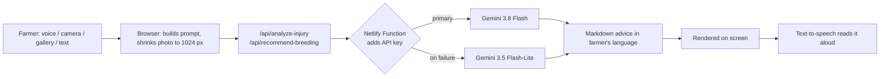

# Maweshi AI (مویشی AI)

**Gaiye Bachao, Doodh Barhao.** A voice-first livestock doctor for farmers who can't read or type.

[**Live demo**](https://maweshi-ai.netlify.app/) · Built for **AICon '26 — Build With AI** (Agricultural Operations), SEECS, NUST

---

## The problem

Livestock is **14.6% of Pakistan's GDP** and supports **8+ million rural families**, who earn **35–40% of their household income** from it (Pakistan Economic Survey 2025-26). Reported losses from animal disease run to roughly **US$200 million a year** (Frontiers in Veterinary Science, 2020).

When an animal falls sick, a vet can take **1–2 days** to arrive (team estimate). Many illnesses and wounds respond to simple first aid in the first hours, but the farmer often doesn't know what to do. Breeding decisions suffer too: with no guidance, crossbreeding is based on habit rather than the farmer's goal.

On top of that, most apps assume the user can read English and type. Many livestock keepers can't.

## The solution

Maweshi AI lets a farmer **speak, snap a photo, and listen**. No reading or typing is required.

| Capability | What the farmer does | What they get |
| --- | --- | --- |
| **First aid from a photo** | Picks an animal, takes or uploads a photo, optionally records a voice note or types a description | Likely cause, immediate first aid, cleanliness and precautions, and when to call a vet |
| **Crossbreeding guide** | Enters their animals (by voice or text) and picks a goal | Best pairing, benefits for the offspring, and important precautions |
| **Vet connect** | Opens the vet list | One-tap call or WhatsApp to Islamabad livestock and agriculture vets |
| **Voice and language** | Picks a language on first open (it's remembered) | Everything in that language, right-to-left where needed, with answers read aloud |

### Built for low-literacy users

- Voice in, voice out: record your problem, tap **Listen** to hear the answer.
- Animal picker uses large icons (🐄 🐃 🐐 🐑), not menus of text.
- The AI is instructed to use short, simple sentences "a farmer with no schooling can follow".
- Language is chosen once and remembered; the layout switches to RTL automatically.

## Languages

| Language | Text and AI reply | Spoken answer (TTS) |
| --- | --- | --- |
| Urdu | ✅ | Urdu voice |
| English | ✅ | English voice |
| Pashto | ✅ | Pashto voice |
| Sindhi | ✅ | Sindhi voice |
| Punjabi (Shahmukhi) | ✅ | Urdu voice (no native voice available) |
| Saraiki | ✅ | Urdu voice (no native voice available) |
| Balochi | ✅ | Urdu voice (no native voice available) |
| Hindko | ✅ | Urdu voice (no native voice available) |

Google TTS has no native voice for Punjabi (Shahmukhi), Saraiki, Balochi or Hindko, so those languages are read aloud with the Urdu voice in this MVP.

## How the AI works



1. **Multimodal input.** The photo and the farmer's voice note (WAV, base64) are sent to Gemini **together in one request**, so the model sees and hears the problem at once.
2. **Role and language prompting.** The prompt casts the model as a livestock care specialist, names the animal, forces the reply into the farmer's language and script (no Latin letters for non-English), and transliterates vet terms into the local script.
3. **Structured output.** First-aid replies follow four fixed sections: *likely cause*, *immediate first aid*, *cleanliness and precautions*, *when to call a vet*. Breeding replies follow three: *best pairing*, *benefits for the offspring*, *important precautions*.
4. **Reliability.** Each request tries `gemini-3.8-flash` first and falls back to `gemini-3.5-flash-lite`, with a 12-second timeout per attempt.
5. **Security.** The API key lives only in a Netlify environment variable; the browser never sees it.
6. **Weak-network friendly.** Photos are downscaled to 1024 px JPEG before upload.

> **Not a diagnosis.** Maweshi AI gives first-aid guidance and tells the farmer when to call a vet. It does not replace a veterinarian.

## Tech stack

| Layer | Technology |
| --- | --- |
| Frontend | HTML5, CSS3, vanilla JavaScript (RTL layout), no framework |
| Backend | Netlify Functions (Node.js 18+) |
| AI | Google Gemini API: `gemini-3.8-flash`, fallback `gemini-3.5-flash-lite` |
| Voice output | Google Translate TTS via a Netlify Function, with Web Speech API fallback |
| Libraries | [marked](https://github.com/markedjs/marked) (CDN), Google Fonts (CDN) |
| Hosting | Netlify |

## Repository structure

```
maweshi-ai/
├── netlify/functions/
│   ├── analyze-injury.js      # Gemini call for photo + voice first-aid analysis
│   ├── recommend-breeding.js  # Gemini call for crossbreeding recommendations
│   └── tts.js                 # Text-to-speech (audio output) proxy
├── public/
│   └── favicon.ico
├── src/
│   ├── index.html             # App shell
│   ├── css/style.css          # Styling
│   └── js/
│       ├── api.js             # Prompts, language rules, calls to /api/*
│       ├── app.js             # UI logic, language picker, vet list, image shrinking
│       └── audio.js           # Voice recording and spoken playback
├── .env.example               # Environment variable template
├── netlify.toml               # Publish dir, functions dir, /api/* redirect
└── package.json
```

## Getting started

**Prerequisites:** Node.js 18+, the [Netlify CLI](https://docs.netlify.com/cli/get-started/) (`npm install -g netlify-cli`), and a [Gemini API key](https://aistudio.google.com/apikey).

```bash
git clone https://github.com/alihaider1145/maweshi-ai.git
cd maweshi-ai
cp .env.example .env     # then set MAWESHI_GEMINI_KEY in .env
npm start                # runs `netlify dev`
```

**Environment variables**

| Variable | Purpose |
| --- | --- |
| `MAWESHI_GEMINI_KEY` | Gemini API key, read by the Netlify Functions |

On Netlify, set the same variable under *Site configuration → Environment variables*.

## Privacy

Photos and voice notes are sent to the Gemini API to produce a reply. Maweshi AI's own functions do not store them. The only thing saved in the browser is the chosen language.

## Limitations and roadmap

**Today (MVP)**
- Advice quality depends on photo clarity and on Gemini; there is no veterinary validation layer yet.
- Four languages are spoken with an Urdu voice (see the table above).
- The vet directory covers Islamabad only.

**Next**
- Urgency triage (green / yellow / red) with an automatic "call a vet" prompt
- Saved animal records so breeding advice can use health and family history
- Vet-validated knowledge base and confidence indicators
- Native voices for Punjabi, Saraiki, Balochi and Hindko
- Vet network beyond Islamabad

## Team Alu Biryani

Syed Hassan Azfar · Ali Haider · Haseeb Zafar · M. Ibraheem Javed · Ahmed Ali

Built during **AICon '26** (NUST SEECS, 9–11 October 2026). Third-party tools we credit: Google Gemini API, Google Translate TTS, Web Speech API, marked.js, Google Fonts, Netlify.

## Sources

- Pakistan Economic Survey 2025-26 (livestock: 62.4% of agricultural value added, 14.6% of GDP, 8M+ rural families, 35–40% of household income)
- Frontiers in Veterinary Science (2020), participatory study of bovine health issues across Pakistan's agroecological zones (reports annual animal-disease losses of about US$200 million)